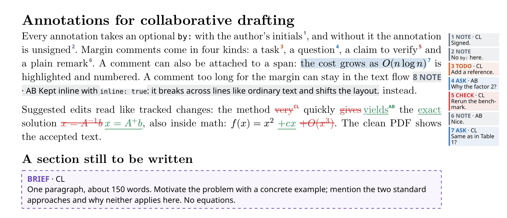

# my-typst-utilities

Small, self-contained [Typst](https://typst.app) libraries. Each one is a single file with no
dependencies: copy it into your project and import it. Tested with Typst 0.15.

| Library | Purpose |
|---|---|
| [`annot`](#annot) | Margin comments, drafting briefs and suggested edits for collaborative drafting |

## annot

[`annot/annot.typ`](annot/annot.typ) adds margin comments, drafting briefs and suggested edits
to a Typst document. They show in draft PDFs and disappear from the final one.
[`annot/demo.typ`](annot/demo.typ) shows every feature.



### Setup

Copy `annot.typ` into your project, e.g.

```sh
curl -O https://raw.githubusercontent.com/CarloLucibello/my-typst-utilities/main/annot/annot.typ
```

and add, before the template's show rule if there is one:

```typst
#import "annot.typ": *
#show: annot-setup
```

### Annotations

Every annotation takes an optional `by:` with the author's initials.

| Source | Draft PDF | Clean PDF |
|---|---|---|
| `#todo[...]`, `#ask[...]`, `#check[...]`, `#note[...]` | numbered margin comment, one color per kind | hidden |
| `#ask[span][question]` (any of the four) | highlighted span with a margin comment | span as plain text |
| `#note(inline: true)[...]` | comment in the text flow, for long ones | hidden |
| `#brief[...]` | box saying what a section should contain | hidden |
| `#del[old]`, `#ins[new]`, `#repl[old][new]` | red strikethrough, green underline | edit applied |

### Modes

```sh
typst compile main.typ                        # draft: annotations visible
typst compile --input annot=clean main.typ    # accepted text only
typst compile --input annot=final main.typ    # fails while any annotation remains
```

Where command-line inputs are not available (the typst.app editor), set the mode in the file:
`#show: annot-setup.with(mode: "clean")`.

Adding `annot-setup` does not change the layout: with the mode given on the command line, a
document without annotations compiles to the same pages as before.

### Caveats

- Typst swallows a `;` written right after any function call in text, as in `#todo[...];`
  (it ends the code expression). Put the annotation after the semicolon, or escape it:
  `#todo[...]\;`.
- Inside an equation, give the annotated part its own `$...$`, as in
  `$f = a #del[$+ b$]$`. Otherwise the brackets hold text, not math.
- Margin comments use the page's existing margin, about 19 mm on A4 with 25 mm margins, so
  keep them short. Use `inline: true` or a `#brief` for longer text.
